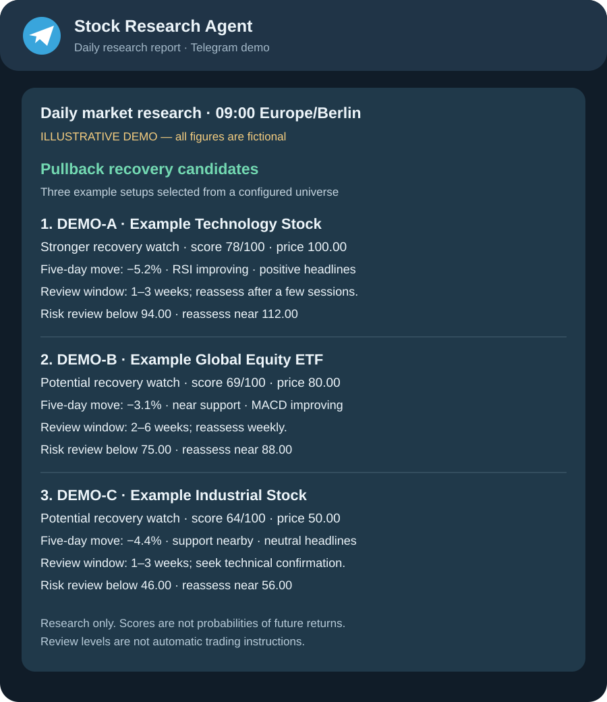

# Automated Stock Research Agent

An automated Python research agent that searches a user-configured universe of
stocks and ETFs, evaluates market data and news, and sends daily Telegram reports.

It combines Yahoo Finance data through yfinance, technical indicators, fundamental
and risk signals, and Google News RSS headline sentiment. Reports include ranked
candidates and recent-pullback recovery ideas with review horizons and price levels.

## Features

- Stock and ETF analysis with RSI, MACD, moving averages, ATR, and support/resistance.
- Explainable scores and headline sentiment.
- Up to five recovery candidates from the symbols you configure.
- Daily Telegram reports through GitHub Actions; manual runs are also available.
- Optional private portfolio summaries using an encrypted repository secret.
- CLI, Streamlit dashboard, and mocked notification tests.

## Telegram report demo

The agent sends a research shortlist with technical and news context, review
horizons, and risk-review levels.



*Illustrative mockup with fictional symbols and figures. Actual candidates,
wording, and report length depend on configuration and available data.*

## Setup

Python 3.12 is recommended. From the project folder:

```powershell
python -m venv .venv
.\.venv\Scripts\python.exe -m pip install -r requirements.txt
Copy-Item .env.example .env
```

Set `TELEGRAM_BOT_TOKEN` and `TELEGRAM_CHAT_ID` in your local `.env`.
Never commit credentials or personal investment information.

No watchlist is supplied. Add your chosen symbols to `data/market_universe.csv`
using the columns `symbol,asset_type,enabled,exchange`. Asset types are `STOCK`
or `ETF`; set `enabled` to `true` for symbols to scan. This file becomes public
if committed. Use a private repository for confidential symbol selections.

```powershell
python main.py analyze SYMBOL
python main.py monitor --universe --daily-report --rebound-top 5
python -m streamlit run dashboard/streamlit_app.py
python -m pytest -q
```

## Automatic Telegram delivery

In repository Settings → Secrets and variables → Actions, configure
`TELEGRAM_BOT_TOKEN` and `TELEGRAM_CHAT_ID`. Enable the included Weekday Market
Monitor workflow on the default branch. Use Actions → Weekday Market Monitor →
Run workflow to test it.

The weekday workflow starts early and waits until 09:00 Europe/Berlin before
starting its scan. Installation, scanning, and GitHub queue delays affect delivery
time; exact 09:00 delivery is not guaranteed. A late-starting job sends when ready.

## Optional private portfolio

The default public package contains no personal holdings. Copy
`config/portfolio.example.json` to the ignored `config/portfolio.json` for local
use. For cloud reports, put its contents in the `PORTFOLIO_CONFIG_JSON` repository
secret. Avoid public workflow logs and artifacts containing private report content.

## Interpretation and limitations

Scores measure matches to screening rules, not probabilities of future returns.
Recovery horizons are review windows, and risk/target levels are prompts for
reassessment. Weakest-ranked candidates are not necessarily sell signals.
Headline sentiment is a simple keyword model. Data can be delayed or unavailable;
large universes can encounter provider limits. This software executes no trades.

For educational research only. Outputs are not personalized investment advice
or guarantees. Verify data and consider your own investment horizon and risk.

## License

MIT; see LICENSE.
