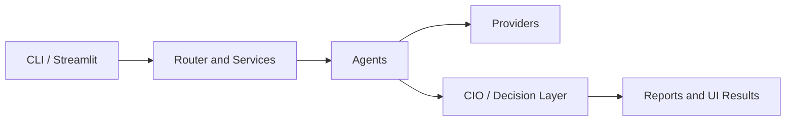

# Architecture

## Overview

The AI Stock Research Assistant follows a layered architecture that separates user interfaces, application orchestration, analytical logic, and external data access.

## Layers

### Interfaces
- CLI
- Streamlit dashboard

### Application layer
- router
- workflows
- services

### Agents
- technical
- news
- fundamental
- risk
- screener
- CIO

### Providers
- Yahoo Finance
- Google News RSS
- future FRED/SEC providers

### Reporting
- HTML
- charts
- dashboard output

## Design Principles

1. Single responsibility per module.
2. No dashboard-to-provider imports.
3. Shared service layer for all interfaces.
4. Structured, typed agent outputs.
5. Traceable references for every external source.
6. LLMs explain verified data rather than inventing market facts.
7. No automatic broker execution in v1.
